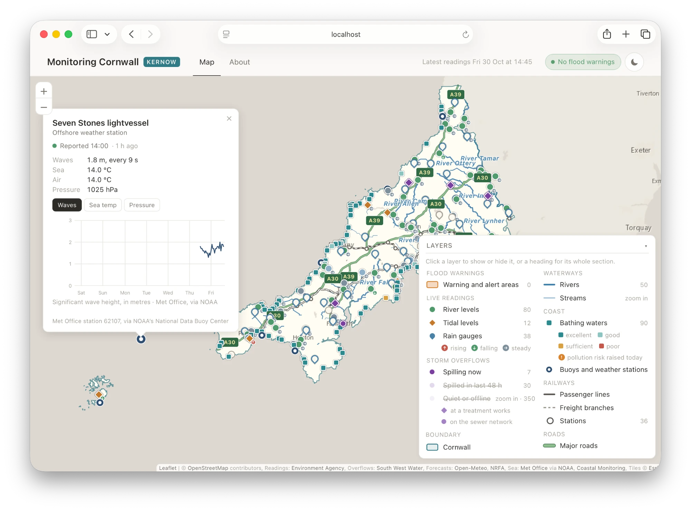

# Monitoring Cornwall



Monitoring Cornwall shows which of the county's rivers are high and rising, which storm overflows are spilling, how clean the water is at each beach, and what the rain and the rivers are forecast to do next. It brings the Environment Agency's gauges, flood warnings and bathing waters, South West Water's storm overflow monitors, Met Office observations at sea and Open-Meteo's forecasts together on one map of Cornwall, drawn from [OpenStreetMap](https://www.openstreetmap.org/). It's a companion to [Floodwatch](https://github.com/aallan/floodwatch), which monitors the River Taw catchment in Devon at [tawriver.watch](https://tawriver.watch).

The site is a single page with no framework and no build step. The server, the readings poller and the map data pipeline use only the Python standard library, with readings kept in SQLite.

## What the map shows

Flood warnings and alerts come from the Environment Agency, which issues flood warnings (severe, and ordinary) for specific places, and flood alerts for wider areas. When any are in force in Cornwall, a banner under the header says how many of each; opening it lists them with the Agency's message, and "Show on map" zooms to the area. Each area in force is drawn on the map, red for a severe flood warning, amber for a flood warning and yellow for a flood alert, and clicking it shows the same message. When none are in force, the header says so.

Live readings come from the Environment Agency's [real-time flood-monitoring API](https://environment.data.gov.uk/flood-monitoring/doc/reference). Stations take a reading every 15 minutes, which the Environment Agency usually publishes within about half an hour, and the server checks for new ones every 5 minutes.

| Layer | Marker | Notes |
|---|---|---|
| River levels | Circle | Green within the station's typical range, red above it, pale blue below it, and grey where no range is published |
| Tidal levels | Amber diamond | Height in metres above Ordnance Datum where the station reports it |
| Rain gauges | Drop | Filled when rain fell in the last hour. Gauges are named after the nearest village |

River and tidal markers carry a small arrow when the level is rising or falling, from a straight line fitted to the last hour's readings; a change of less than 1 cm an hour counts as steady. A marker turns hollow when its station has sent nothing for three hours. Clicking one opens its latest reading and a chart of the last 24 hours, 7 days or 28 days. A river level's chart starts at zero and runs to 1.25 times the top of its typical range, or higher if the river has been higher in the last 28 days, with a dashed line at the top of the typical range and a dotted one at the record high when that fits. The axis stays the same across all three periods, so they compare by eye. Tidal charts fit the tides recorded, and rain is drawn as totals per 15 minutes, hour or day.

Rain gauges add the next 48 hours of forecast rain, hour by hour, from [Open-Meteo](https://open-meteo.com/). The level gauges at Gunnislake on the Tamar, Pillaton on the Lynher, Restormel on the Fowey and Sladesbridge on the Camel add a river flow forecast: daily flow for the past week and the next fortnight, with the spread of the forecast ensemble, against the river's normal and high flows.

Storm overflows come from South West Water's [storm overflow activity feed](https://www.arcgis.com/home/item.html?id=cabfce76b72a4a278a33d737c0708d42), which reports whether each overflow's Event Duration Monitor shows it spilling. There are 387 in the county, so the map shows them in tiers, in one purple shaded by state:

| Marker | Meaning | Shown |
|---|---|---|
| Saturated, pulsing | Spilling now | At every zoom |
| Medium | Spilled in the last 48 hours | At every zoom, once switched on |
| Pale | Quiet: no spill in the last 48 hours | From zoom 11, once switched on |
| Hollow grey | Monitor offline | From zoom 11, once switched on |

Only the overflows spilling now are shown when the page opens; the other tiers are switched on from the legend.

Overflows at sewage treatment works, the inlet overflows and storm tanks, are drawn as diamonds, and those on the sewer network or at pumping stations as circles. In the 2025 annual returns an overflow at a works spilled for 747 hours on average, against 173 hours for the others. The type of each overflow comes from those returns.

An overflow's popup shows its spills over the last 30 days as a timeline, and its spill hours and spill count for each year from the regulatory [annual returns](https://www.arcgis.com/home/item.html?id=66fef44a4aab438991d7ce08fbc1de64).

Around the coast, the map shows the Environment Agency's 90 designated bathing waters in Cornwall; the Isles of Scilly have none. Each is a square coloured by its latest annual classification, which rests on four years of samples: Excellent, Good, Sufficient or Poor. During the bathing season, May to September, the Agency forecasts each morning whether the day's pollution risk is raised, usually after heavy rain, and a square carries an amber badge when it is. A bathing water's popup shows its latest sample and charts its last 25, for E. coli and intestinal enterococci in turn, on a log scale against the Excellent standard for coastal waters: 250 and 100 per 100 ml. Bars above that standard are amber, and above the Sufficient standard (500 and 185) red. The popup links to the Agency's profile of the bathing water.

Wave buoys and weather stations report the sea and the weather around the coast. The Regional Coastal Monitoring Programme's buoys at Looe Bay, Penzance, Perranporth, Porthleven, Port Isaac and St Mary's Sound measure wave height, period and direction and the sea temperature every half hour, and its weather stations at Bude, Looe Bay, Perranporth and Port Isaac measure wind, air temperature and pressure; a site with both is one station on the map. Offshore, the Met Office's Seven Stones lightvessel, between Land's End and the Isles of Scilly, measures waves, and its E1 buoy, about 35 km south of Looe, measures wind, each hour. Every station's popup charts the last week of whatever it measures.

All of these markers grow as the map zooms in.

The rest of the map comes from OpenStreetMap.

| Layer | OpenStreetMap source | Notes |
|---|---|---|
| County boundary | Relations [57537](https://www.openstreetmap.org/relation/57537) (Cornwall) and [158039](https://www.openstreetmap.org/relation/158039) (Isles of Scilly) | Everything outside the county is dimmed |
| Rivers | `waterway=river` and `waterway=canal` | One line per named river, with flow arrows from zoom 12. Each river ends where it meets the dimmed water outside the county. The two canals that still hold water, the Bude Canal and the Par Canal, are included |
| Streams | `waterway=stream` | Shown from zoom 12 |
| Passenger lines | `railway=rail` | The Cornish Main Line and the Atlantic Coast, Maritime, Looe Valley, Tamar Valley and St Ives Bay lines |
| Freight branches | `railway=rail` with `usage=industrial` or `freight` | The china clay lines around Par and St Blazey |
| Stations | `railway=station` and `railway=halt` | National Rail stations, each with its CRS code |
| Major roads | `highway=trunk`, `primary` or `motorway` with a one- or two-digit A-road `ref` | The A30, A38 and A39, labelled with their numbers. Slip roads are left out |

Every layer is on when the page opens, apart from the storm overflows that aren't spilling now. Hovering over a river, line, road or station shows its name. Each row in the legend switches its layer on and off, and each section heading (Flood warnings, Live readings, Storm overflows, Waterways, Railways, Roads) switches the whole section. A layer that's off is dimmed and struck through. The page follows the system's light or dark setting, with a toggle to override it.

## Running it

You'll need Python 3.10 or later, `make`, `curl` and `shasum`.

```bash
git clone https://github.com/aallan/monitoring-cornwall.git
cd monitoring-cornwall
make libs     # download Leaflet into site/lib and check it against libs.sha256
make data     # build the overlays in site/data
make serve    # serve the site at http://localhost:8090, polling for readings
```

The server's first poll lists the stations, then fetches 28 days of history for each of them, four at a time, which takes a few minutes; markers appear when it finishes. Later polls take a few seconds. `make poll` runs a single poll without the server.

`make data` takes a few minutes on a first run, most of it waiting on the public [Overpass API](https://wiki.openstreetmap.org/wiki/Overpass_API) servers. Raw responses are cached in `.cache/overpass/` for a day, so a second run within that window takes seconds. Two flags change that behaviour:

```bash
python3 scripts/fetch_geodata.py --refresh   # ignore the cache and download everything again
python3 scripts/fetch_geodata.py --cached    # rebuild from the cache, however old
```

## Deployment

Monitoring Cornwall runs as one self-contained process on a single server, and its data lives there with it. Nothing generated is committed to this repository: Leaflet and the map overlays are built on the machine that serves the site, by `make libs` and `make data`, and readings collect in `data/monitor.db`.

`serve.py` is a small threaded HTTP server. It serves `site/`, answers `/api/stations/<id>/readings?days=N`, `/api/overflows/<id>` and `/api/marine/<id>?days=N` from the database, `/api/forecast/rain/<id>` and `/api/forecast/flow/<id>` from Open-Meteo, and `/api/bathing/<id>` from the Environment Agency, and polls the Environment Agency in a background thread; `--no-poll` turns the poller off where something else runs `python3 -m monitor.poll`. It binds to `localhost` on port 8090 by default; `--bind` and a port argument change both. Every response includes a Content Security Policy that allows scripts, styles and data from the site's own origin, plus basemap tiles from `server.arcgisonline.com`, and nothing else.

Readings are kept indefinitely. 28 days of readings from all the county's stations take about 34 MB, so a year takes roughly 450 MB. The overflow spill log and the offshore observations are built up by polling and can't be fetched again, so the database is worth backing up.

### On a server

The public site runs on an Ubuntu 24.04 server, with [Caddy](https://caddyserver.com/) in front for HTTPS. `deploy/` holds the configuration:

```
deploy/monitoring-cornwall.service       the web server and poller, as a systemd service
deploy/monitoring-cornwall-data.service  rebuilds the map overlays from OpenStreetMap
deploy/monitoring-cornwall-data.timer    runs that rebuild every Sunday morning
deploy/Caddyfile                         HTTPS for cornwall.watch, and redirects from the other names
```

The server needs about 40 MB of memory and the overlay rebuild about 160 MB, so the smallest server is enough. Point the domain's DNS at the server first, A and AAAA records for the bare name and `www`, so Caddy can get its certificates when it starts. Then, as root:

```bash
apt update && apt install -y git make curl gnupg python3 debian-keyring debian-archive-keyring apt-transport-https
curl -1sLf https://dl.cloudsmith.io/public/caddy/stable/gpg.key | gpg --dearmor -o /usr/share/keyrings/caddy-stable-archive-keyring.gpg
curl -1sLf https://dl.cloudsmith.io/public/caddy/stable/debian.deb.txt > /etc/apt/sources.list.d/caddy-stable.list
apt update && apt install -y caddy

useradd --system --no-create-home --home-dir /srv/monitoring-cornwall --shell /usr/sbin/nologin monitor
install -d -o monitor -g monitor /srv/monitoring-cornwall
cd /srv/monitoring-cornwall
runuser -u monitor -- git clone https://github.com/aallan/monitoring-cornwall.git .
runuser -u monitor -- make libs
runuser -u monitor -- make data

cp deploy/*.service deploy/*.timer /etc/systemd/system/
systemctl daemon-reload
systemctl enable --now monitoring-cornwall monitoring-cornwall-data.timer
cp deploy/Caddyfile /etc/caddy/Caddyfile
systemctl reload caddy

ufw allow OpenSSH && ufw allow 80/tcp && ufw allow 443 && ufw --force enable
```

The first `make data` can take half an hour or more when the public Overpass servers are busy. Each finished query is cached, so if it gives up, running it again carries on from there. To skip the download, copy the cache from a machine that has already run `make data`, and build from it on the server:

```bash
rsync -a .cache/overpass/ root@your-server:/srv/monitoring-cornwall/.cache/overpass/
```

```bash
cd /srv/monitoring-cornwall && chown -R monitor:monitor .cache
runuser -u monitor -- python3 scripts/fetch_geodata.py --cached
```

The service runs as the unprivileged `monitor` user and can write only to `data/`, `site/data/` and `.cache/`. Settings that don't belong in the repository go in `/etc/monitoring-cornwall.env`, readable only by root, which the service reads at start. The one it uses is `CCO_API_KEY`, the Channel Coastal Observatory's API key for the coastal stations:

```bash
install -m 600 -o root -g root /dev/null /etc/monitoring-cornwall.env
echo 'CCO_API_KEY=…' >> /etc/monitoring-cornwall.env
systemctl restart monitoring-cornwall
``` Its log is in the journal:

```bash
journalctl -u monitoring-cornwall -f
```

To update, pull and restart:

```bash
cd /srv/monitoring-cornwall && runuser -u monitor -- git pull && systemctl restart monitoring-cornwall
```

## How live readings are collected

`monitor/` holds the server-side code. Once a day the poller lists the Environment Agency's level and rainfall stations within 110 km of the county, keeps those inside the county boundary or within 1.5 km of it (so the gauges on both banks of the Tamar are included), and reads each river station's published typical range. Stations that have reported nothing in 28 days are left off the map. Some stations list an old series beside the one that replaced it, and the poller uses whichever has a reading in the last week.

Every 5 minutes it makes one request per kind of reading for the latest value from every station in England, keeps Cornwall's, and writes `site/data/live.json`, about 25 KB with every station's latest reading and state, which is everything the map needs to draw its markers. Then it fills gaps. A station whose newest reading is more than 15 minutes ahead of what was stored has missed readings, because the server was down or because the station uploads in batches, so its history is fetched from its last stored reading, four stations at a time. `live.json` is written again once the gaps are filled. A station's history is fetched from `/api/` only when its popup opens.

## How flood warnings are collected

Once a day the poller lists the Environment Agency's flood areas within 110 km of the county and keeps those whose county list includes Cornwall or the Isles of Scilly. Areas shared with Devon, such as the Tamar's, are listed as 'Cornwall, Devon', and the API's own county filter misses them, which is why the list is built this way; it has 84 areas. Every 5 minutes the poller reads the warnings in force across England, keeps those in Cornwall's areas, and writes them to `site/data/warnings.json`. An area's outline is fetched the first time it has a warning, simplified to about 25 m, and kept: alert areas can run to well over a megabyte as published. The Agency gives warning times without a timezone; they're read as UK clock time.

## How storm overflows are collected

The overflow feed reports each overflow's current state and only its most recent spill, so the spill history is built up by polling. Every 5 minutes the poller reads all of South West Water's overflows in one request, about 380 KB, and for each of Cornwall's compares the latest spill with the last one stored. A new start time is a new spill, and the same start time with the overflow now quiet closes the open one. A spill that starts and ends entirely between two polls is still caught, because the feed keeps it as the latest event until the next one, but if two spills happen between polls the earlier is missed. The log starts when the server first runs, so the 30-day panel fills in over its first month. After each poll the server writes `site/data/overflows.json`, about 60 KB, for the markers; an overflow's log and yearly totals come from `/api/overflows/<id>` when its popup opens.

An overflow counts as Cornish if it's inside the county boundary. Outfalls often sit offshore, beyond the low-water line, so one outside the boundary still counts if it's within 3 km of it and nearer to Cornwall than to Devon or Plymouth. That takes in the outfalls in Cawsand Bay and on the Cornish side of the Tamar, and leaves out Plymouth's. Once a day the poller refreshes the list, and reads names, asset types and yearly totals from the annual returns, matching rows to overflows by permit ID.

## How the coast is collected

Every hour the poller reads all of Cornwall's bathing waters from the Environment Agency's bathing water quality API in one request, with each one's sampling point, latest classification, pollution risk forecast and sample, and writes `site/data/bathing.json`. A forecast is shown until it expires, so outside the season none is. A bathing water's last 25 samples come from `/api/bathing/<id>`, which the server fetches from the Agency when a popup asks and keeps for six hours.

Every 30 minutes it reads the offshore stations' observation files from NOAA's National Data Buoy Center, which republishes the Met Office's hourly reports, and the coastal stations from the Channel Coastal Observatory's API. The API needs a key issued for the site's domain, which the server reads from the `CCO_API_KEY` environment variable and sends with the domain as the `Referer`; without a key the coastal stations are skipped. The poller lists the API's sensors within 3 km of the county and nearer to Cornwall than to Devon that have reported in the last month, the same test the overflows use, takes each one's position from the API, and fetches up to a week of history the first time it sees a sensor and only what's missing after that. `site/data/marine.json` holds each station's latest value of everything it measures, and `/api/marine/<id>` returns up to 28 days for the popup charts.

## How forecasts are fetched

Forecasts are fetched by the server when a popup asks for one, so visitors' browsers only ever talk to the site itself. Rain forecasts are kept for 15 minutes and flow forecasts for an hour, and if Open-Meteo can't be reached the last good answer is served.

Flow forecasts come from [GloFAS](https://global-flood.emergency.copernicus.eu/), the Copernicus global flood model, through Open-Meteo's flood API. GloFAS routes rivers on a grid of cells about 5 km across, and at that scale a Cornish river often runs through the cell next to its gauge rather than the one under it. `scripts/calibrate_flow.py` reads the model's 2015–2024 flows in the 25 cells around a National River Flow Archive gauging station and lists those whose mean flow is closest to the gauged mean; the chosen cell for each river is in `monitor/forecast.py`. The model's flows in that cell are scaled so their long-run mean matches the gauged mean, which the server reads from the NRFA and keeps for a week. The normal flow line is that mean, and the high flow line is the flow the scaled model exceeds one day in ten. GloFAS smooths peaks, so its own one-in-ten flow is a fairer mark for its forecasts than the gauged one.

In the Tamar's cell the model has about half the river's gauged flow, so its flows are doubled; after scaling, the model's low and high flows match the gauged record to within 7%. The Fal was tried and left out, because the forecast for its cell runs far below anything in the model's own history there.

## How the map loads

The map opens on mainland Cornwall and the Isles of Scilly at the closest zoom that shows both. The legend can sit over open sea and over a small corner of the mainland, usually the Rame peninsula, but not over Scilly or the rest of the county. On a phone, where both won't fit, it opens on the mainland. Each layer of the map draws as soon as its file arrives, without waiting for the others. Streams, the largest overlay, load the first time the map is zoomed in far enough to show them.

## How the overlays are built

`scripts/fetch_geodata.py` queries Overpass for the county boundary, coastline, waterways, railways, stations and major roads, and writes simplified GeoJSON to `site/data/`, along with a `meta.json` that records when the data was downloaded.

Queries select Cornwall by relation ID. The UK county is tagged `Kernow / Cornwall`, and a query on the name `Cornwall` returns Cornwall, Ontario.

OpenStreetMap draws river centrelines down the middle of each estuary to the open sea, which on a map reads as a river flowing across open water. The county boundary follows the low-water line, so it runs up the lower reaches of most estuaries, and the map dims everything outside it. Each river is trimmed where it leaves the boundary, which ends it where it meets that dimmed water. The Fal, for example, ends just above King Harry Ferry rather than running down Carrick Roads to Falmouth Bay.

The Tamar works differently, because its centreline is the boundary. The area query misses most of it, so the script fetches it by name along its whole valley. It never leaves the boundary, so it ends at its tidal limit instead: its `tidal=yes` ways are dropped, and it is cut where it crosses `natural=coastline` at Gunnislake weir.

Railway ways are classified by line name, then by `usage` tag. Heritage and tourist railways are left off the map, as are yards, sidings and crossovers.

## Tests

`make test` runs both test suites, which use only Python's `unittest` and Node's built-in test runner, so there's nothing to install beyond Python 3.10 or later and Node 22 or later. The Python tests cover the poller, the spill log, flood warnings, forecasts, bathing waters, offshore stations, geometry and the server's endpoints and headers; each runs against a temporary database, with the Environment Agency, South West Water, Open-Meteo, NRFA and NOAA replaced by fixed responses, several of them trimmed copies of real ones in `tests/fixtures/`, so they need no network. The JavaScript tests load the page's scripts into a sandbox and check the chart arithmetic, the escaping and the tooltip text. GitHub Actions runs `make test` on every push to `main` and every pull request, on Python 3.10 and 3.13.

## Project layout

```
serve.py                  HTTP server for site/ and /api/, and the poller thread
monitor/ea.py             Environment Agency client: stations, latest readings, history
monitor/poll.py           the 5-minute poll cycle
monitor/live.py           writes site/data/live.json
monitor/overflows.py      South West Water storm overflows: list, spill log, annual totals
monitor/floods.py         Environment Agency flood warnings and alerts, and their areas
monitor/forecast.py       rain and river flow forecasts from Open-Meteo, and the flow outlets
monitor/bathing.py        Environment Agency bathing waters: classifications, forecasts, samples
monitor/marine.py         offshore and coastal stations: Met Office reports via the NDBC, and the CCO's buoys
monitor/net.py            HTTP requests with a time limit on the whole answer
monitor/cache.py          fetching popup data on demand, with an in-memory cache
monitor/db.py             SQLite schema and connection
monitor/geo.py            boundary geometry shared with the overlay builder
scripts/fetch_geodata.py  OpenStreetMap to site/data/*.geojson, data/places.json and data/neighbours.geojson
scripts/calibrate_flow.py finds the GloFAS cell that carries a river past an NRFA gauge
scripts/og_image.py       draws site/img/og-image.png, the link preview card, with headless Chrome
libs.sha256               checksums for the downloaded Leaflet files
site/index.html           the page
site/css/style.css        layout and theme, light and dark
site/js/map.js            basemap, boundary mask, overlays, station markers and legend
site/js/stations.js       station and overflow popups and their charts
site/js/floods.js         the flood warning banner and header indicator
site/js/app.js            tab routing and the status line
site/js/utils.js          escaping, formatting and the theme toggle
tests/                    Python tests (unittest), one file per module
tests/js/                 JavaScript tests (node --test)
deploy/                   systemd units and Caddy configuration for a server
```

## Contributing

Bug reports, corrections and pull requests are welcome; [CONTRIBUTING.md](CONTRIBUTING.md) covers setup and conventions. Everyone taking part is expected to follow the [code of conduct](CODE_OF_CONDUCT.md).

## Licence

The code is released under the [MIT licence](LICENSE).

The map data is © OpenStreetMap contributors, available under the [Open Database Licence](https://www.openstreetmap.org/copyright). This uses Environment Agency flood and river level data from the real-time data API (Beta), available under the [Open Government Licence](https://www.nationalarchives.gov.uk/doc/open-government-licence/version/3/). Storm overflow activity is © South West Water, under [CC BY 4.0](https://creativecommons.org/licenses/by/4.0/), and the overflow annual returns are © Environment Agency copyright and/or database right, under the Open Government Licence. Weather and river flow forecasts are from [Open-Meteo](https://open-meteo.com/), under [CC BY 4.0](https://creativecommons.org/licenses/by/4.0/), with river flows generated using Copernicus Emergency Management Service information. Mean river flows are data from the UK National River Flow Archive. Bathing water data are © Environment Agency, under the Open Government Licence. Offshore observations are the Met Office's, as republished by NOAA's National Data Buoy Center. Real time data from the wave buoys and coastal weather stations are from the Regional Coastal Monitoring Programme, made freely available under the terms of the Open Government Licence; they are real-time data and are not quality-controlled. Basemap tiles are © [Esri](https://www.esri.com/). [Leaflet](https://leafletjs.com/) is released under the BSD 2-Clause licence.
